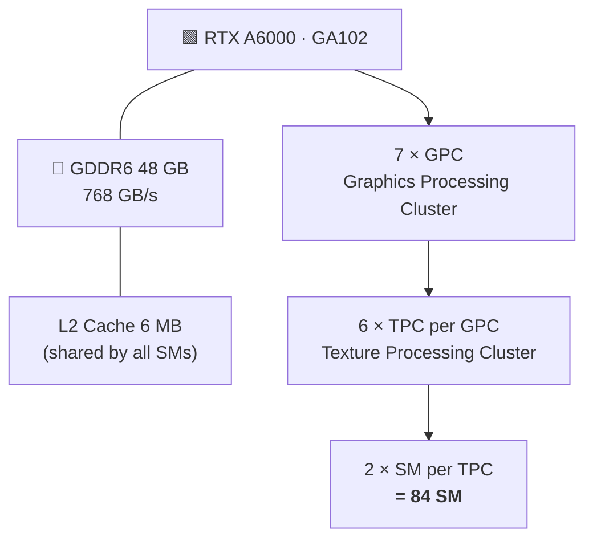
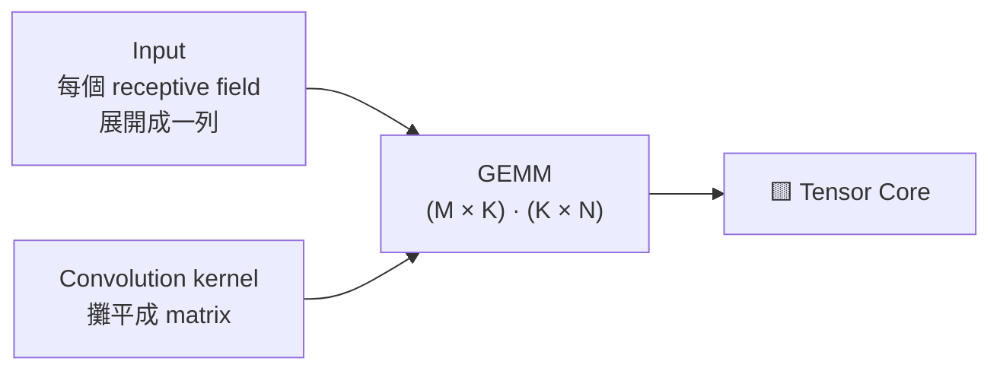
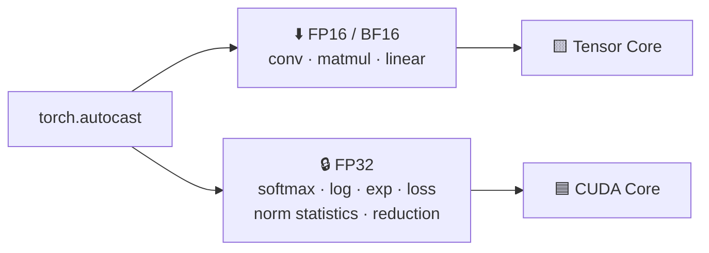
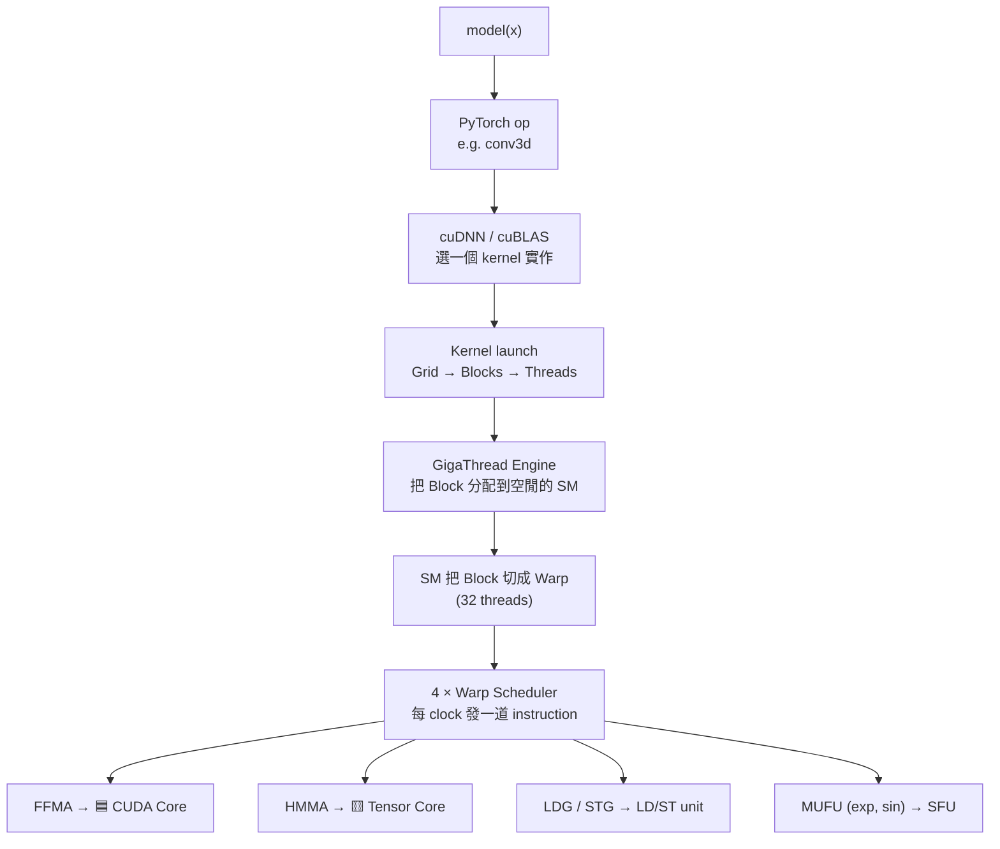

<!-- markdownlint-disable MD051 MD001 MD033 -->
# 🟩 NVIDIA RTX A6000 架構筆記

<div align="center">

### 10,752 CUDA Cores × 336 Tensor Cores — 從硬體到 PyTorch / MONAI 訓練


</div>

---

## ⚡ TL;DR

| | |
| :-- | :-- |
| 🔢 **10,752 怎麼來** | 84 SM × 128 FP32 lane |
| 🧮 **336 怎麼來** | 84 SM × 4 Tensor Core |
| 🟦 **CUDA Core 負責** | scalar FP32 FMA → elementwise、norm、loss、optimizer |
| 🟨 **Tensor Core 負責** | matrix multiply-accumulate → convolution、matmul |
| 🚀 **Tensor Core 有多強** | 同一個 SM 內，4 顆 Tensor Core = 128 顆 CUDA Core 的 **4 倍** throughput |
| 🧱 **3D 分割真正的 bottleneck** | **memory bandwidth** + 不必要的 padding |
| 🎛️ **你能控制的** | 不是「分配 core」，而是讓 kernel **有條件走 Tensor Core**（AMP / TF32 / alignment / channels_last）並**減少無效計算** |

---

## 📑 目錄

| | 章節 | | 章節 |
| :-: | :-- | :-: | :-- |
| 1 | [📋 Specifications](#-1-specifications) | 8 | [🧭 Execution Model](#-8-execution-model) |
| 2 | [🏗️ Hardware Hierarchy](#️-2-hardware-hierarchy) | 9 | [🐍 PyTorch 設定](#-9-pytorch-設定) |
| 3 | [🔬 SM Internals](#-3-sm-internals) | 10 | [📈 Monitoring & Profiling](#-10-monitoring--profiling) |
| 4 | [🟦 CUDA Core](#-4-cuda-core) | 11 | [🏥 實例：MONAI SegResNetDS](#-11-實例monai-segresnetds) |
| 5 | [🟨 Tensor Core](#-5-tensor-core) | 12 | [⚖️ 與其他 GPU 比較](#️-12-與其他-gpu-比較) |
| 6 | [🔢 Numeric Formats](#-6-numeric-formats) | 13 | [❓ FAQ](#-13-faq) |
| 7 | [🧠 Memory Hierarchy & Roofline](#-7-memory-hierarchy--roofline) | 14 | [📌 Cheat Sheet](#-14-cheat-sheet) |

---

## 📋 1. Specifications

<table>
<tr><td valign="top" width="50%">

#### 🧩 Compute

| Item | Value |
| :-- | :-- |
| GPU chip | GA102（完整 die） |
| Architecture | Ampere |
| Compute Capability | **sm_86** |
| SM | **84** |
| CUDA Core | **10,752** |
| Tensor Core | **336**（3rd gen） |
| RT Core | 84（2nd gen） |
| Boost Clock | ~1.8 GHz |

</td><td valign="top" width="50%">

#### 💾 Memory & System

| Item | Value |
| :-- | :-- |
| VRAM | **48 GB GDDR6 + ECC** |
| Memory bus | 384-bit |
| Memory bandwidth | **768 GB/s** |
| L2 Cache | 6 MB |
| L1 / Shared | 128 KB / SM |
| Register File | 256 KB / SM |
| Interface | PCIe 4.0 x16 |
| NVLink | 112 GB/s（2 卡，合計 96 GB） |
| Power | 300 W |
| MIG | ❌ |

</td></tr>
</table>

### 🚀 Peak Throughput（Dense）

| Precision | Execution unit | TFLOPS | vs FP32 | |
| :-- | :-- | --: | :-: | :-- |
| FP64 | FP64 unit（2 / SM） | 0.6 | 1/64 | `▏` |
| FP32 | 🟦 CUDA Core | **38.7** | 1× | `██` |
| FP16（half2，非 Tensor） | 🟦 CUDA Core | 38.7 | 1× | `██` |
| **TF32** | 🟨 Tensor Core | **77.4** | 2× | `████` |
| **FP16 / BF16**（FP32 accumulate） | 🟨 Tensor Core | **154.8** | 4× | `████████` |
| INT8 | 🟨 Tensor Core | 309.7 TOPS | 8× | `████████████████` |
| INT4 | 🟨 Tensor Core | 619.4 TOPS | 16× | `████████████████████████████████` |

> [!NOTE]
> 規格表上的 **309.7 TFLOPS Tensor performance** 是 FP16 搭配 **2:4 structured sparsity** 的數字。一般 dense 訓練的上限是 **154.8**。

<details>
<summary>🧮 <b>驗算</b></summary>

```text
FP32        : 10,752 cores × 2 FLOP (FMA) × 1.8 GHz         ≈  38.7 TFLOPS ✓
FP16 Tensor :    336 TC    × 128 FMA/clk × 2 × 1.8 GHz      ≈ 154.8 TFLOPS ✓
```

</details>

---

## 🏗️ 2. Hardware Hierarchy



```text
┌──────────────────────── SM (Streaming Multiprocessor) ────────────────────────┐
│  L1 / Shared Memory 128 KB   │  1 × RT Core  │  4 × Texture  │  2 × FP64 unit  │
├───────────────────┬───────────────────┬───────────────────┬───────────────────┤
│      SMSP 0       │      SMSP 1       │      SMSP 2       │      SMSP 3       │
│ Warp Scheduler    │ Warp Scheduler    │ Warp Scheduler    │ Warp Scheduler    │
│ Register 64 KB    │ Register 64 KB    │ Register 64 KB    │ Register 64 KB    │
│ 🟦 16 FP32        │ 🟦 16 FP32        │ 🟦 16 FP32        │ 🟦 16 FP32        │
│ 🟦 16 FP32/INT32  │ 🟦 16 FP32/INT32  │ 🟦 16 FP32/INT32  │ 🟦 16 FP32/INT32  │
│ 🟨 1 Tensor Core  │ 🟨 1 Tensor Core  │ 🟨 1 Tensor Core  │ 🟨 1 Tensor Core  │
│ 4 SFU · 4 LD/ST   │ 4 SFU · 4 LD/ST   │ 4 SFU · 4 LD/ST   │ 4 SFU · 4 LD/ST   │
└───────────────────┴───────────────────┴───────────────────┴───────────────────┘
```

| | 每 SMSP | × 4 SMSP = 每 SM | × 84 SM = 全卡 |
| :-- | :-: | :-: | :-: |
| 🟦 CUDA Core | 32 | 128 | **10,752** |
| 🟨 Tensor Core | 1 | 4 | **336** |

> [!IMPORTANT]
> Tensor Core 數量雖然只有 CUDA Core 的 **1/32**，但每一顆都是「小型 matrix engine」：
>
> | 同一個 SM 內 | FMA / clock |
> | :-- | --: |
> | 🟦 128 × CUDA Core（FP32） | 128 |
> | 🟨 4 × Tensor Core（FP16） | **512** |
>
> → 做 matrix 運算時，Tensor Core 是 **4 倍**。

---

## 🔬 3. SM Internals

### 3.1 SM 是 scheduling 的基本單位

GPU 不是一顆一顆 core 各做各的，而是以 **SM 為單位接收 thread block**，再以 **warp（32 threads）為單位執行**。

### 3.2 sm_86 Resource Limits

| Resource | 每 SM 上限 |
| :-- | --: |
| Resident threads | 1,536 |
| Resident warps | 48 |
| Resident blocks | 16 |
| Registers | 65,536（256 KB） |
| Registers / thread | 255 |
| Shared memory | 100 KB（每 block ≤ 99 KB） |
| L1 + Shared | 128 KB |

### 3.3 Occupancy

$$\text{Occupancy} = \frac{\text{resident warps}}{48}$$

- **為什麼重要**：GPU 靠 **warp switching** 來 hide memory latency；一個 warp 在等資料時，scheduler 立刻換另一個 warp 執行。
- **限制因素**：每個 thread 用太多 register、每個 block 用太多 shared memory，都會減少 resident warp。

> [!TIP]
> cuDNN / cuBLAS 的 kernel 已經調好，**一般使用者不用管 occupancy**；只有寫 custom CUDA kernel 或 Triton 時才需要注意。

---

## 🟦 4. CUDA Core

### 4.1 CUDA Core 到底是什麼

- 行銷名詞，實際上是 **FP32 ALU lane**。
- 不是 CPU 那種獨立 core：沒有自己的 instruction stream，**32 個 lane 一起執行同一道 instruction**（**SIMT**, Single Instruction Multiple Threads）。
- 每個 clock 每個 lane 做 **1 個 FMA**（`a × b + c` = 2 FLOP）。

### 4.2 Ampere GA10x 的「FP32 Doubling」

```text
每個 SMSP ─┬─ 16 × FP32 only
           └─ 16 × FP32 / INT32（二選一）
```

- 沒有 integer ops → 32 lane 全做 FP32 → **128 FP32/clk/SM**
- 有 integer ops（address calculation、loop index）→ 部分 lane 被 INT32 佔走 → **實際 FP32 throughput < 38.7 TFLOPS**
- 這是 A6000 的 CUDA Core 數「看起來」是 Turing 的 2 倍、實際效能卻不到 2 倍的原因。

### 4.3 Deep learning 中跑在 CUDA Core 上的 operation

| Operation | Characteristic |
| :-- | :-- |
| ReLU、PReLU、GELU、Sigmoid | elementwise |
| BatchNorm、InstanceNorm、LayerNorm | reduction + elementwise |
| Softmax、Loss（Dice、CE） | reduction |
| Residual add、concat、upsampling | elementwise / data movement |
| Optimizer step（AdamW） | elementwise |
| GPU data augmentation | elementwise / indexing |

> [!NOTE]
> 共同點：**每讀一個數字只算一兩次** → bottleneck 是 **memory bandwidth**，不是 CUDA Core 的 compute。

### 4.4 Warp Divergence

- 同一個 warp 內的 thread 遇到 `if/else` 走不同 branch → 兩條 branch **依序執行**，各 mask 掉一部分 thread → efficiency 下降。
- PyTorch 使用者幾乎無感；寫 custom kernel 時才要注意。

---

## 🟨 5. Tensor Core

### 5.1 做什麼

一顆 Tensor Core 每次執行一個 **small matrix multiply-accumulate (MMA)**：

$$D = A \times B + C$$

| Precision | MMA shape (M×N×K) | Accumulation |
| :-- | :-: | :-: |
| FP16 / BF16 | `m16n8k16` | FP32（或 FP16） |
| TF32 | `m16n8k8` | FP32 |
| INT8 | `m16n8k32` | INT32 |
| INT4 | `m16n8k64` | INT32 |

> [!TIP]
> Profiler 中 kernel 名稱出現 **`16816`**，就是 `m16n8k16` 的 FP16/BF16 Tensor Core instruction。

### 5.2 Tensor Core Generations

| Gen | Architecture | 代表 GPU | 新增 precision / 功能 |
| :-: | :-- | :-- | :-- |
| 1 | Volta | V100 | FP16 |
| 2 | Turing | RTX 20、T4 | INT8、INT4 |
| **3** | **Ampere** | **A100、A6000、RTX 30** | **TF32、BF16、2:4 Sparsity** |
| 4 | Hopper / Ada | H100、RTX 40、L40 | FP8、Transformer Engine |
| 5 | Blackwell | B200、RTX 50 | FP4、FP6 |

> [!WARNING]
> A6000 **不支援 FP8**；能用的最低訓練 precision 是 **FP16 / BF16**。

### 5.3 Convolution → GEMM

cuDNN 會把 convolution 轉成 **implicit GEMM**：



以 3D conv `3×3×3, Cin=32, Cout=32` 為例：

| GEMM dimension | 對應 | 數值 |
| :-: | :-- | --: |
| **K** | kernel volume × Cin | 3·3·3·32 = **864** |
| **N** | Cout | **32** |
| **M** | output voxels | 256³ ≈ **16.8 M** |

### 5.4 Tensor Core Trigger Conditions

| 條件 | 要求 |
| :-- | :-- |
| ✅ **Precision** | FP16 / BF16 / TF32 / INT8；**純 FP32 且關掉 TF32 → 不會用** |
| ✅ **Dimension alignment** | FP16/BF16 → channel 為 **8 的倍數**；TF32 → 4；INT8 → 16 |
| ✅ **Memory layout** | `channels_last`（NHWC / NDHWC），避免 layout conversion |
| ✅ **Algorithm selection** | cuDNN 要挑到 Tensor Core 版本（`cudnn.benchmark=True` 會實測挑最快） |

Misaligned 時，cuDNN 可能自動 pad，或退回非 Tensor Core 的 kernel。

### 5.5 2:4 Structured Sparsity

- 每 4 個 weights 強制 2 個為 0 → Tensor Core 跳過 → 理論 **2×**。
- 需要特別的 pruning 流程，**一般訓練用不到**。

---

## 🔢 6. Numeric Formats

```text
          sign  exponent        mantissa
FP32  :   [1]   [8 ████████]    [23 ███████████████████████]
TF32  :   [1]   [8 ████████]    [10 ██████████]
FP16  :   [1]   [5 █████]       [10 ██████████]
BF16  :   [1]   [8 ████████]    [ 7 ███████]
```

| Format | Bits | Exp | Mantissa | Range | Precision | Usage |
| :-- | :-: | :-: | :-: | :-- | :-- | :-- |
| FP32 | 32 | 8 | 23 | ±3.4e38 | ~7 digits | Default |
| **TF32** | 19 | 8 | 10 | = FP32 | = FP16 | Tensor Core 內部算 FP32 matmul / conv |
| FP16 | 16 | 5 | 10 | **±65,504** | ~3 digits | AMP |
| **BF16** | 16 | 8 | 7 | = FP32 | ~2 digits | AMP（Ampere+） |

### 6.1 TF32

- 程式碼不用改，tensor 仍是 FP32；只在 Tensor Core 內部把 mantissa **truncate 成 10 bit** 來乘，**accumulate 仍是 FP32**。
- 速度是 FP32 CUDA Core 的 **2×**（77.4 vs 38.7 TFLOPS）。

| PyTorch flag | Default | 影響 |
| :-- | :-: | :-- |
| `torch.backends.cudnn.allow_tf32` | `True` | **Convolution 預設已用 TF32** |
| `torch.backends.cuda.matmul.allow_tf32` | `False` | Linear、attention 預設**不用** |

### 6.2 FP16 vs BF16

| | FP16 | BF16 |
| :-- | :-: | :-: |
| Dynamic range | 小（max 65,504） | = FP32 |
| Precision | 較高 | 較低 |
| GradScaler | ⚠️ **需要** | ✅ **不需要** |
| Overflow risk | 有（loss → inf / NaN） | 幾乎沒有 |
| A6000 Tensor Core | 154.8 TFLOPS | 154.8 TFLOPS |
| 建議 | 舊 GPU 相容 | ⭐ **Ampere 以上首選** |

### 6.3 AMP（Automatic Mixed Precision）怎麼分配



- Weights 的 **master copy 仍是 FP32**；optimizer update 在 FP32。

---

## 🧠 7. Memory Hierarchy & Roofline

### 7.1 Memory Hierarchy

```text
            速度 ▲                                   容量 ▼
 ┌─────────────────────────┐
 │ Register   256 KB / SM  │  ~1 cycle
 ├─────────────────────────┤
 │ L1/Shared  128 KB / SM  │  ~30 cycles
 ├─────────────────────────┤
 │ L2         6 MB         │  ~200 cycles
 ├─────────────────────────┤
 │ GDDR6      48 GB        │  ~400–600 cycles · 768 GB/s
 ├─────────────────────────┤
 │ PCIe 4.0   → CPU RAM    │  μs · ~32 GB/s
 └─────────────────────────┘
```

| Level | Capacity | Bandwidth | Latency | Scope |
| :-- | :-- | :-- | :-- | :-- |
| Register | 256 KB / SM | fastest | ~1 cycle | thread |
| L1 / Shared | 128 KB / SM | 數十 TB/s（全卡） | ~30 cycles | block |
| L2 | 6 MB | 數 TB/s | ~200 cycles | all SMs |
| **GDDR6** | **48 GB** | **768 GB/s** | ~400–600 cycles | device |
| PCIe 4.0 x16 | — | ~32 GB/s unidirectional | μs | host ↔ device |
| NVLink | — | 112 GB/s bidirectional | — | 2 × A6000 |

> [!NOTE]
> L2 只有 **6 MB**（A100 為 40 MB）；3D 醫學影像的 feature map 動輒數百 MB，**幾乎每一層都要回 GDDR6 read/write**。

### 7.2 Roofline Model

$$\text{Arithmetic Intensity (AI)} = \frac{\text{FLOPs}}{\text{Bytes read/written}}
\qquad
\text{Ridge point} = \frac{\text{Peak compute}}{\text{Memory bandwidth}}$$

| Execution unit | Peak | Ridge point |
|:--|--:|--:|
| 🟦 FP32 CUDA Core | 38.7 TFLOPS | **≈ 50 FLOP/B** |
| 🟨 TF32 Tensor Core | 77.4 TFLOPS | **≈ 101 FLOP/B** |
| 🟨 FP16 Tensor Core | 154.8 TFLOPS | **≈ 202 FLOP/B** |

```text
 TFLOPS
   154.8 ┤                         ┌──────────────── FP16 Tensor Core
         │                       ╱
    77.4 ┤                  ┌───╱───────────────── TF32 Tensor Core
         │                ╱   ╱
    38.7 ┤          ┌───╱───╱───────────────────── FP32 CUDA Core
         │        ╱   ╱   ╱
         │      ╱   ╱   ╱      ◀ memory-bound │ compute-bound ▶
         │    ╱   ╱   ╱
         └──┴───┴───┴───────────────────────────▶ Arithmetic Intensity
               50  101 202                        (FLOP / Byte)
```

- 🔴 **AI < ridge point → Memory-bound**：加再多 compute 也沒用
- 🟢 **AI > ridge point → Compute-bound**

### 7.3 常見 operation 的 AI

| Operation | AI（FLOP/B） | 狀態 |
|:--|--:|:--|
| ReLU（FP16） | ~0.25 | 🔴 severely memory-bound |
| Elementwise add | ~0.17 | 🔴 memory-bound |
| InstanceNorm | ~1–2 | 🔴 memory-bound |
| 3D Conv 3×3×3, C 32→32（FP16） | ~數十 | 🟠 低於 ridge |
| 3D Conv 3×3×3, C 256→256 | ~數百 | 🟢 compute-bound |
| Large matmul（4096²） | ~1000+ | 🟢 compute-bound |

> [!IMPORTANT]
> 1. 高 resolution、低 channel 的淺層 3D conv **到不了 Tensor Core 的 ridge point**，實際 throughput 遠低於 154.8。
> 2. Norm、activation 吃掉大量時間，但幾乎不用 Tensor Core。
> 3. 這解釋了 3D 分割訓練時 `nvidia-smi` 的 **mem% 常常很高**。

### 7.4 改善 Memory-bound

| 方法 | 原理 |
|:--|:--|
| 🔻 **FP16 / BF16** | data size 減半 |
| ✂️ **減少 padding** | 不搬、不算無效的 0 |
| 🔗 **Kernel fusion** | 多個 elementwise 合成一個 kernel，只 read/write 一次（`torch.compile`、MONAI `INSTANCE_NVFUSER`） |
| 🧱 **channels_last** | 避免 layout conversion 的額外 data movement |

---

## 🧭 8. Execution Model

> **為什麼不能「指定」用哪些 core？**



> [!IMPORTANT]
> - 用 CUDA Core 還是 Tensor Core，是由 **kernel 裡的 instruction**（`FFMA` vs `HMMA`）決定，不是由使用者分配。
> - 你能做的：**讓 cuDNN 挑得到 Tensor Core kernel**（precision、alignment、layout），以及**給足夠的 workload**讓 84 個 SM 都有 block 可跑。
> - 同一個 CUDA stream 上的 kernel **依序執行**，所以「CUDA Core 跑 norm 的同時 Tensor Core 跑 conv」在一般訓練中很少發生。

### Wave & Tail Effect
- 一個 kernel 有 N 個 block，每個 SM 同時放 k 個 → 一個 **wave** = 84 × k 個 block。
- N 只比整數個 wave 多一點 → 最後一個 wave 只有少數 SM 在忙 → **tail effect**（小 batch、小 tensor 時特別明顯）。

---

## 🐍 9. PyTorch 設定

### 9.1 Global flags（放在訓練程式開頭）

```python
import torch

# cuDNN autotune：輸入大小固定時，實測挑最快的 algorithm
torch.backends.cudnn.benchmark = True

# 讓 FP32 運算也走 Tensor Core（TF32）
torch.backends.cuda.matmul.allow_tf32 = True   # default: False
torch.backends.cudnn.allow_tf32 = True         # default: True
# 等價：torch.set_float32_matmul_precision("high")
```

> [!WARNING]
> `cudnn.deterministic = True`（例如 MONAI `set_determinism()`、Auto3DSeg 的 `determ: true`）會**強制關掉 benchmark**，改用 reproducible 但較慢的 algorithm。

### 9.2 AMP

<table>
<tr><th>FP16（需要 GradScaler）</th><th>BF16（Ampere+，不需要 GradScaler）⭐</th></tr>
<tr><td>

```python
scaler = torch.amp.GradScaler("cuda")
for x, y in loader:
    optimizer.zero_grad(set_to_none=True)
    with torch.autocast("cuda",
                        dtype=torch.float16):
        loss = loss_fn(model(x), y)
    scaler.scale(loss).backward()
    scaler.step(optimizer)
    scaler.update()
```

</td><td>

```python
for x, y in loader:
    optimizer.zero_grad(set_to_none=True)
    with torch.autocast("cuda",
                        dtype=torch.bfloat16):
        loss = loss_fn(model(x), y)
    loss.backward()
    optimizer.step()
```

</td></tr>
</table>

### 9.3 channels_last & torch.compile

```python
# 3D 資料用 channels_last_3d（NDHWC）
model = model.to(memory_format=torch.channels_last_3d)
x = x.to(memory_format=torch.channels_last_3d)

# Kernel fusion：把 elementwise chain 合併，減少 memory round-trip
model = torch.compile(model)
```

> [!TIP]
> 3D 的 dynamic shape（例如 sliding window 邊界）可能觸發 recompile；搭配**固定的 roi size** 比較穩定。

### 9.4 Alignment & Size

| 項目 | 建議 |
|:--|:--|
| Channel 數 | **8 的倍數**（FP16/BF16），最好是 16、32、64… |
| Batch × spatial | 夠大，讓 GEMM 的 M dimension 能填滿 84 個 SM |
| Patch / ROI size | 每軸是 2^(downsampling 層數) 的倍數，且**貼近實際影像大小** |

### 9.5 ✅ Checklist

- [ ] `amp: true`（或手動 `autocast`）
- [ ] `cudnn.benchmark = True`，且沒被 deterministic 蓋掉
- [ ] TF32 開啟
- [ ] `channels_last`
- [ ] Channel 數為 8 的倍數
- [ ] ROI 沒有過度 padding
- [ ] Data loader 跟得上（SM utilization 持續 > 90%）

---

## 📈 10. Monitoring & Profiling

### 10.1 `nvidia-smi`

```bash
nvidia-smi                          # 總覽：memory usage、power、temperature、utilization
nvidia-smi dmon -s u                # 每秒：sm%、mem%
nvidia-smi dmon -s pucm             # + power(p)、clock(c)、memory usage(m)
nvidia-smi -q -d CLOCK,PERFORMANCE  # 是否因 temperature / power throttling
```

| 欄位 | ✅ 真正意義 | ❌ 常見誤解 |
|:--|:--|:--|
| `sm %` | 取樣期間**有任何 kernel 在跑的時間比例** | 「多少 core 在忙」 |
| `mem %` | 取樣期間 **memory controller 在 read/write 的時間比例** | 「VRAM 用了多少」 |
| Power | 接近 300 W → 真的高負載 | — |

**🔍 判讀**

| 現象 | 判斷 |
|:--|:--|
| sm% < 80%、波動大 | 🔴 **Data loading / CPU bottleneck** |
| sm% ≈ 100%、mem% 高 | 🟠 **GPU 滿載，偏 memory-bound** |
| sm% ≈ 100%、power ≈ 300 W | 🟢 **Compute-intensive** |

### 10.2 PyTorch Profiler（不需 sudo）

```python
from torch.profiler import profile, ProfilerActivity

with profile(activities=[ProfilerActivity.CPU, ProfilerActivity.CUDA]) as prof:
    for i, batch in enumerate(train_loader):
        train_step(batch)
        if i == 5:
            break

print(prof.key_averages().table(sort_by="cuda_time_total", row_limit=20))
prof.export_chrome_trace("trace.json")   # 用 chrome://tracing 或 Perfetto 開啟
```

**🔎 從 kernel 名稱判斷是否走 Tensor Core**

| Kernel 名稱關鍵字 | 意義 |
|:--|:--|
| 🟨 `16816`、`1688` | Tensor Core MMA（FP16/BF16、TF32） |
| 🟨 `xmma`、`sm80_`、`sm86_` | NVIDIA Tensor Core kernel |
| 🟨 `cutlass` + `tensorop` | CUTLASS Tensor Core kernel |
| 🟨 `ampere_*_gemm`、`*_tf32_*` | Ampere Tensor Core GEMM |
| 🟦 `sgemm`、`implicit_convolve_sgemm`（無 tf32） | ⚠️ **FP32 CUDA Core，沒走 Tensor Core** |
| 🟦 `elementwise_kernel`、`reduce_kernel` | CUDA Core，memory-bound |
| 🟦 `instance_norm`、`nvfuser_*` | Norm / fused kernel |

### 10.3 Nsight Systems — Timeline

```bash
nsys profile -o report --trace=cuda,nvtx,osrt python train.py
nsys stats report.nsys-rep
```

- GPU timeline 上有空白 → GPU 在等 CPU / data loader
- 找出最耗時的 kernel

### 10.4 Nsight Compute — 單一 kernel 深入

```bash
ncu --kernel-name regex:xmma --launch-count 5 \
    --metrics sm__pipe_tensor_op_hmma_cycles_active.avg.pct_of_peak_sustained_active,\
dram__throughput.avg.pct_of_peak_sustained_elapsed,\
sm__throughput.avg.pct_of_peak_sustained_elapsed \
    python train.py
```

| Metric | 意義 |
|:--|:--|
| `sm__pipe_tensor_op_hmma_cycles_active` | Tensor Core 實際忙碌比例 |
| `dram__throughput` | Memory bandwidth utilization |
| `sm__throughput` | SM 整體 utilization |
| Achieved occupancy | 實際 resident warp 比例 |

> [!NOTE]
> 需要 root 或設定 `NVreg_RestrictProfilingToAdminUsers=0`。Nsight Compute 會讓程式大幅變慢，只抓少數 kernel。

### 10.5 DCGM — 長時間監控

```bash
dcgmi dmon -e 1001,1002,1004,1005
# 1001 GR_ENGINE_ACTIVE    1002 SM_ACTIVE
# 1004 PIPE_TENSOR_ACTIVE  1005 DRAM_ACTIVE
```

需要安裝 `datacenter-gpu-manager` 並啟動 `nv-hostengine`（需管理員權限）。

---

## 🏥 11. 實例：MONAI SegResNetDS

> KiTS23 Stage2 · Auto3DSeg · 2 × RTX A6000

### 11.1 觀測結果

```text
# gpu   sm   mem
    0   98    91
    1   99    88
    0   99    84
    1  100    94
```

→ ✅ GPU 已滿載，**不是 data loading bottleneck**；mem% 高代表大量時間花在 data movement。

### 11.2 Config 檢視

| Config | Value | 影響 |
|:--|:--|:--|
| `amp` | `true` | ✅ Conv 走 FP16 Tensor Core |
| `channels_last` | `true` | ✅ |
| `norm` | `INSTANCE_NVFUSER` | ✅ Norm 已 fusion |
| `init_filters` | `32` | ✅ 8 的倍數 |
| `determ` | `true` | ⚠️ 關掉 cudnn.benchmark（約慢 10–30%） |
| `roi_size` | `[256, 256, 256]` | 🔴 **大量 padding** |
| `batch_size` / `num_crops_per_image` | `1` / `1` | 🟡 48 GB 下仍有空間 |
| `cache_rate` / `num_workers` | `0` / `4` | 🟡 目前沒卡住，加速後可能變 bottleneck |

### 11.3 ROI Padding 的 compute 浪費

Resample 到 0.78125 mm 後的影像尺寸：

| | X | Y | Z |
|:--|:-:|:-:|:-:|
| Median | 289 | **121** | **166** |
| 90th percentile | 326 | 162 | 204 |
| 目前 `roi_size` | 256 | **256** | **256** |

```text
真實影像比例 = (256 × 121 × 166) / 256³ = 121 × 166 / 65,536 ≈ 30.6 %

 有效 voxel  ██████░░░░░░░░░░░░░░  30.6 %
 Padding 0   ░░░░░░██████████████  69.4 %   ← Tensor Core 與 bandwidth 白白浪費
```

**💡 建議**

```yaml
roi_size: [256, 160, 208]   # 每軸為 16 的倍數（5 層 downsampling → 2⁴）
determ: false               # 若不需要完全 reproducible
```

| 指標 | 原本 `[256,256,256]` | 建議 `[256,160,208]` |
|:--|:-:|:-:|
| 計算量 | 100% | **≈ 51%** |
| 有效 voxel 比例（median 影像） | 30.6% | **≈ 60%** |
| 省下的 VRAM | — | 可換成 `num_crops_per_image: 2` 或稍大的 roi |

### 11.4 一次 forward / backward 的分配

| Stage | Execution unit | Bottleneck |
|:--|:--|:--|
| Encoder / Decoder 3D Conv | 🟨 Tensor Core（FP16） | 淺層 memory-bound、深層 compute-bound |
| InstanceNorm + PReLU（nvfuser） | 🟦 CUDA Core | Memory bandwidth |
| Residual add、upsampling、deep supervision | 🟦 CUDA Core | Memory bandwidth |
| DiceCE Loss（sigmoid） | 🟦 CUDA Core（FP32） | Memory bandwidth |
| AdamW update | 🟦 CUDA Core | Memory bandwidth |
| Sliding window inference + inverse resample | 🟦 CUDA Core / CPU | Bandwidth、OOM 風險 |

### 11.5 改完後怎麼驗證

- [ ] 比較 **epoch time**（不是 sm%，改完仍會是 ~100%）
- [ ] 用 PyTorch Profiler 比較改前 / 改後 conv kernel 總時間
- [ ] 確認 validation Dice 沒有因 roi 變小而下降

---

## ⚖️ 12. 與其他 GPU 比較

| | **RTX A6000** | RTX 3090 | A100 80GB | RTX 6000 Ada | H100 PCIe |
|:--|:-:|:-:|:-:|:-:|:-:|
| Architecture | **Ampere GA102** | Ampere GA102 | Ampere GA100 | Ada AD102 | Hopper GH100 |
| SM | **84** | 82 | 108 | 142 | 114 |
| CUDA Core | **10,752** | 10,496 | 6,912 | 18,176 | 14,592 |
| Tensor Core | **336** (3rd) | 328 (3rd) | 432 (3rd) | 568 (4th) | 456 (4th) |
| FP32 lane / SM | **128** | 128 | 64 | 128 | 128 |
| VRAM | **48 GB GDDR6 ECC** | 24 GB GDDR6X | 80 GB HBM2e | 48 GB GDDR6 ECC | 80 GB HBM2e |
| Bandwidth (GB/s) | **768** | 936 | ~2,000 | 960 | ~2,000 |
| L2 | **6 MB** | 6 MB | 40 MB | 96 MB | 50 MB |
| FP32 (TFLOPS) | **38.7** | 35.6 | 19.5 | 91.1 | 51 |
| FP16 Tensor, FP32 acc. | **154.8** | 71 ⚠️ | 312 | 364 | 756 |
| FP8 | ❌ | ❌ | ❌ | ✅ | ✅ |
| FP64 (TFLOPS) | 0.6 | 0.6 | 9.7 | 1.4 | 26 |
| MIG | ❌ | ❌ | ✅ | ❌ | ✅ |
| Power | 300 W | 350 W | 300 W | 300 W | 350 W |

> [!NOTE]
> - **A6000 vs 3090**：同一顆 GA102，但 GeForce 版「FP16 input、FP32 accumulate」的 Tensor Core throughput 被**減半**；A6000 為全速，並有 48 GB + ECC。
> - **A6000 vs A100**：A6000 的 CUDA Core 數字較大（每 SM 128 vs 64 lane），但 A100 的 Tensor Core throughput 約 **2×**、bandwidth 約 **2.6×**、L2 大 **6×** → 對 memory-bound 的 3D 分割，A100 優勢更明顯。
> - **CUDA Core 數不能跨 architecture 直接比較**。

---

## ❓ 13. FAQ

<details>
<summary><b>Q1：可以指定「只用 Tensor Core」或「用滿 10,752 個 CUDA Core」嗎？</b></summary>

不行。core 由硬體 scheduler 分配；你只能讓 kernel 有條件走 Tensor Core（precision、alignment），並提供足夠的 workload。
</details>

<details>
<summary><b>Q2：<code>nvidia-smi</code> 顯示 100% 就代表 GPU 被榨乾了嗎？</b></summary>

不是。`sm%` 只代表「有 kernel 在跑的時間比例」；一個只用到 1 個 SM 的 kernel 也能讓它顯示 100%。實際 Tensor Core utilization 要用 Profiler / DCGM 看。
</details>

<details>
<summary><b>Q3：開了 AMP，為什麼速度沒有變成 4 倍？</b></summary>

- 只有 conv / matmul 走 Tensor Core；norm、activation、loss、optimizer 仍是 memory-bound。
- 淺層 3D conv 的 arithmetic intensity 不夠高，到不了 Tensor Core peak。
- Data loading、validation、logging 也佔時間。
- 實務上 AMP 帶來 **1.5–3×** 加速就算正常。
</details>

<details>
<summary><b>Q4：FP16 和 BF16 哪個快？</b></summary>

在 A6000 上 Tensor Core 速度相同。BF16 的優點是穩定、不需要 GradScaler。
</details>

<details>
<summary><b>Q5：TF32 會影響 precision 嗎？</b></summary>

對 deep learning 訓練幾乎沒有影響；需要高 precision 的科學計算才要關掉。
</details>

<details>
<summary><b>Q6：加大 batch 一定變快嗎？</b></summary>

GPU 還沒滿載（sm% < 90%）時有幫助；已滿載時只會讓每個 step 變長。要比較的是**每秒處理的 voxel 數**。
</details>

<details>
<summary><b>Q7：兩張 A6000 用 NVLink 會比較快嗎？</b></summary>

DDP 每個 step 要同步 gradient，有 NVLink（112 GB/s）比走 PCIe 快。若兩張卡分別跑不同 fold，則完全不需要 NVLink。
</details>

<details>
<summary><b>Q8：規格表的 309.7 TFLOPS 能達到嗎？</b></summary>

那是 FP16 + 2:4 sparsity 的 peak。一般 dense 訓練上限 154.8，3D 分割實際通常只用到其中一小部分。
</details>

<details>
<summary><b>Q9：為什麼 3D 分割特別吃 bandwidth？</b></summary>

Feature map 是 C × D × H × W：256³ 單通道 FP16 就是 32 MB，32 channels 就是 1 GB，遠超過 6 MB 的 L2；每一層的 input / output 都要經過 GDDR6。
</details>

---

## 📌 14. Cheat Sheet

| 想知道 | 答案 |
|:--|:--|
| 🔢 10,752 怎麼來 | 84 SM × 128 FP32 lane |
| 🧮 336 怎麼來 | 84 SM × 4 Tensor Core |
| 🟦 CUDA Core 做什麼 | scalar FP32 FMA → elementwise / norm / loss |
| 🟨 Tensor Core 做什麼 | small matrix multiply-accumulate → conv / matmul |
| 🚀 FP32 / TF32 / FP16 peak | 38.7 / 77.4 / 154.8 TFLOPS |
| 💾 Memory bandwidth | 768 GB/s |
| 📐 Ridge point（FP16 TC） | ≈ 200 FLOP/B |
| 🏷️ Compute Capability | 8.6 |
| ❌ 不支援 | FP8、MIG |
| ✅ 讓 conv 走 Tensor Core | AMP（FP16/BF16）或 TF32 + channel 為 8 的倍數 |
| ⚙️ 必開 | `cudnn.benchmark=True`、TF32、`channels_last` |
| 🐢 會拖慢 | `cudnn.deterministic=True`（MONAI `determ: true`） |
| 📊 `sm%` | 有 kernel 在跑的時間比例 |
| 📊 `mem%` | memory controller 忙碌的時間比例 |
| 🔎 Tensor Core 有沒有用 | Profiler kernel 名稱含 `16816` / `xmma` / `tensorop` |
| 🧱 3D 分割最大 bottleneck | memory bandwidth + 不必要的 padding |

---

## 📚 References

- [NVIDIA RTX A6000 Datasheet](https://www.nvidia.com/content/dam/en-zz/Solutions/products/workstations/nvidia-rtx-a6000-datasheet.pdf)
- [NVIDIA RTX A6000 Datasheet（繁體中文）](https://www.nvidia.com/content/dam/en-zz/zh_tw/Solutions/design-visualization/quadro/resource/proviz-print-nvidia-rtx-a6000-datasheet-a4-nvidia-1454980-r9-web-zhTW-1558581.pdf)
- [Lenovo Press — NVIDIA RTX A6000 Product Guide](https://lenovopress.lenovo.com/LP1917)
- NVIDIA Ampere GA102 GPU Architecture Whitepaper
- PyTorch Docs — CUDA semantics（TF32）、Automatic Mixed Precision
- NVIDIA Deep Learning Performance Guide（Tensor Core alignment）

<sub>註：§7 的 latency 與 arithmetic intensity 為概略量級；§12 其他 GPU 規格為公開數字整理，用於量級比較。</sub>
