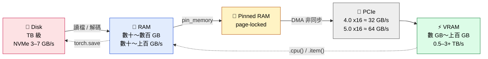
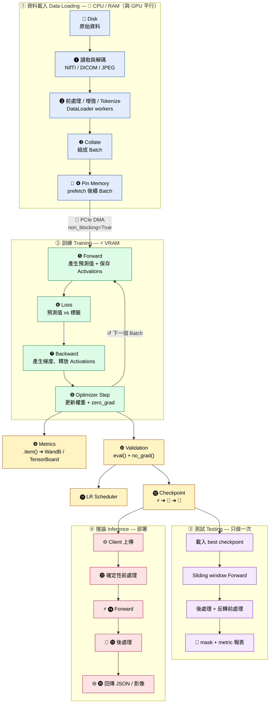
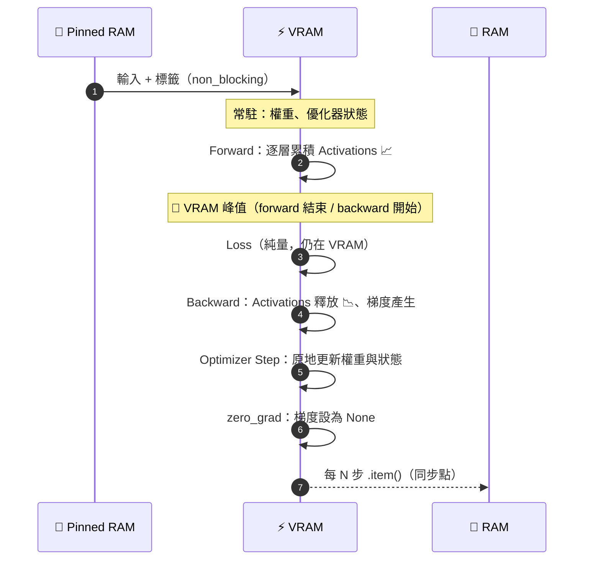
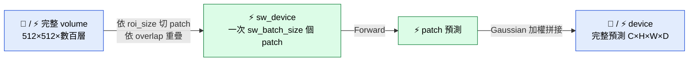
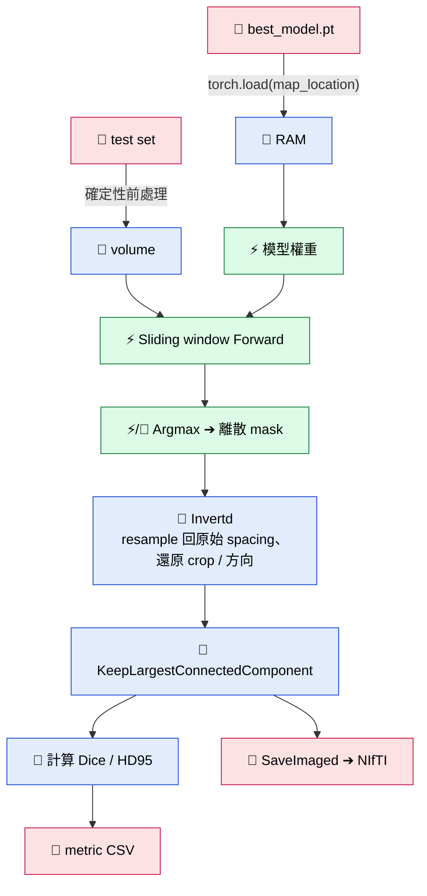
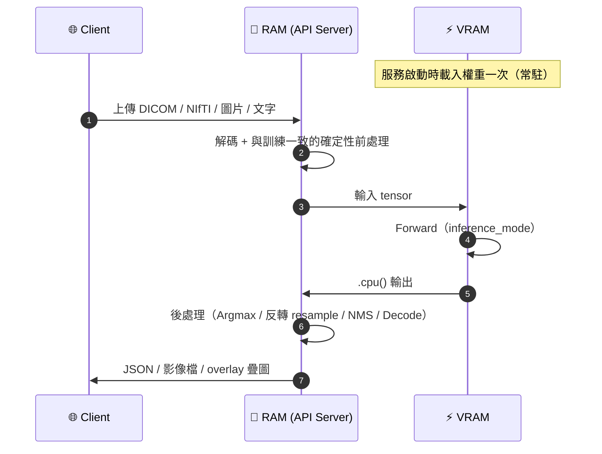
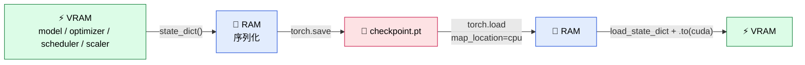

# 🧠 深度學習資料流完整指南

<div align="center">

## Training · Validation · Testing · Inference — 資料到底在哪裡？

以 **PyTorch / MONAI** 為例，追蹤資料在 **💾 Disk → 🧠 RAM → 📌 Pinned RAM → ⚡ VRAM** 之間的流動<br/>
範例以 **3D 醫學影像分割（KiTS23）** 為主，並補充分類、偵測、文本生成的差異

</div>

> [!NOTE]
> 本文件使用 **Mermaid 圖表** 與 **GitHub Alerts**（`[!NOTE]`、`[!TIP]`、`[!WARNING]`）。
> 在 GitHub、Obsidian、Typora、VS Code（Markdown Preview Mermaid Support 擴充）中都能正確顯示。

### 🎨 圖例

| 符號 | 位置 | 符號 | 位置 |
| :---: | --- | :---: | --- |
| 💾 | Disk（SSD / HDD / NAS） | ⚡ | VRAM（GPU 記憶體） |
| 🧠 | RAM（系統記憶體） | 🔀 | PCIe 匯流排 |
| 📌 | Pinned RAM（page-locked） | 🌐 | Client（使用者端） |

---

## 📑 目錄

| | 章節 | | 章節 |
| :---: | --- | :---: | --- |
| 1 | [🏗️ 儲存層級總覽](#️-1-儲存層級總覽) | 9 | [💾 Checkpoint：Disk ↔ VRAM](#-9-checkpointdisk--vram) |
| 2 | [🗺️ 完整流程圖](#️-2-完整流程圖) | 10 | [⏱️ CPU–GPU 同步點](#️-10-cpugpu-同步點) |
| 3 | [📊 四階段資料位置對照表](#-3-四階段資料位置對照表) | 11 | [🧮 VRAM 用量估算](#-11-vram-用量估算) |
| 4 | [📦 資料載入（共用）](#-4-資料載入四個階段共用) | 12 | [💥 常見 OOM 原因與對策](#-12-常見-oom-原因與對策) |
| 5 | [🔥 Training](#-5-training-詳解) | 13 | [📈 記憶體監控](#-13-記憶體監控) |
| 6 | [✅ Validation](#-6-validation-詳解) | 14 | [🖥️ 多 GPU 補充](#️-14-多-gpu-補充) |
| 7 | [🧪 Testing](#-7-testing-詳解) | 15 | [📝 原始流程圖修正對照](#-15-原始流程圖的修正對照) |
| 8 | [🚀 Inference](#-8-inference部署詳解) | | |

---

## 🏗️ 1. 儲存層級總覽



| 層級 | 典型容量 | 頻寬（數量級） | 存放內容 |
| --- | --- | --- | --- |
| 💾 **Disk** | TB 級 | NVMe 約 3–7 GB/s；HDD 約 0.1–0.2 GB/s | 原始資料集、快取、checkpoint、預測結果 |
| 🧠 **RAM（pageable）** | 數十～數百 GB | 數十～上百 GB/s | 解碼後的影像、增強中的資料、CacheDataset 快取 |
| 📌 **Pinned RAM** | 由程式配置 | 同 RAM | 準備送往 GPU 的 batch |
| 🔀 **PCIe** | — | 4.0 x16 理論約 32 GB/s；5.0 約 64 GB/s | 傳輸通道，**常是瓶頸** |
| ⚡ **VRAM** | 數 GB～上百 GB | 約 0.5–3+ TB/s | 權重、優化器狀態、activations、梯度、當前 batch |

> [!IMPORTANT]
> **核心觀念**
>
> - 越往 GPU，速度越快、容量越小。
> - PCIe 頻寬遠低於 VRAM，所以**資料要少來回搬**：一次搬進 VRAM，在 GPU 上算完，只把必要的小結果（純量、最終預測）搬回來。
> - **Pinned memory** 讓 GPU 能用 DMA 直接讀取，可做非同步傳輸（`non_blocking=True`），讓傳輸與計算重疊。

---

## 🗺️ 2. 完整流程圖



---

## 📊 3. 四階段資料位置對照表

| | 🔥 **Training** | ✅ **Validation** | 🧪 **Testing** | 🚀 **Inference** |
| --- | --- | --- | --- | --- |
| **目的** | 更新權重 | 監控泛化、選 checkpoint、早停 | 最終無偏評估 | 對新資料預測 |
| **頻率** | 每個 iteration | 每 N 個 epoch | 訓練後一次 | 依請求持續 |
| 💾 **資料來源** | train set | val set | test set | 🌐 使用者上傳 |
| 🧠 **RAM 中** | 解碼 + **隨機增強** batch | **確定性前處理** batch | 同 Validation，常放整個 volume | 單筆輸入 |
| ⚡ **VRAM 常駐** | 權重 + 優化器狀態 | 同 Training（優化器閒置） | 權重 | 權重 |
| ⚡ **VRAM 每 batch** | 輸入、標籤、**Activations**、**梯度**、預測 | 輸入、標籤、預測 | 輸入 patch、預測 | 輸入 patch、預測 |
| **需要標籤** | ✅ | ✅ | ✅ | ❌ |
| **計算梯度** | ✅ | ❌ | ❌ | ❌ |
| **模式** | `train()` | `eval()` + `no_grad()` | `eval()` + `no_grad()` | `eval()` + `inference_mode()` |
| **典型輸入** | 隨機 crop patch | 整個 volume + sliding window | 整個 volume + sliding window | 整個 volume + sliding window |
| ⚡➔🧠 **回到 RAM** | loss 純量 | metric 數值 | 預測 mask、metric | 後處理結果 |
| 🧠➔💾 **寫回 Disk** | checkpoint、log | 最佳 checkpoint | NIfTI mask、報表 | 視需求 |
| **VRAM 用量** | 🔴🔴🔴🔴 最大 | 🟠🟠🟠 中 | 🟡🟡 小～中 | 🟢 最小 |

> [!TIP]
> **為什麼 Training 的 VRAM 最大？** 因為多了兩大項：
>
> 1. **Activations** — backward 需要 forward 的中間結果，必須全部保存。3D 網路中這通常是**最大宗**（數 GB～數十 GB）。
> 2. **梯度 + 優化器狀態** — 梯度與權重同大小；Adam 再多兩份。
>
> 在 `no_grad()` 下，每層的輸出用完就能丟，同樣的 VRAM 可以處理大得多的輸入。
>
> [!NOTE]
> **Validation vs Testing**：資料放的位置幾乎一樣，差別在**用途與規則**。
> Validation 的結果會影響決策（選 checkpoint、調超參、早停），等於「間接參與訓練」；
> Testing 必須在所有決策完成後才執行，結果**不能**回頭調整任何東西。

---

## 📦 4. 資料載入（四個階段共用）

### 4.1 PyTorch DataLoader 的資料路徑


### 4.2 重要參數

| 參數 | 作用 | 記憶體影響 |
| --- | --- | --- |
| `num_workers` | 平行處理的子進程數 | 🧠 每個 worker 佔自己的 RAM，過多會吃光 RAM |
| `pin_memory=True` | batch 放進 page-locked RAM | 📌 加速傳輸、可非同步 |
| `prefetch_factor` | 每個 worker 預備的 batch 數（預設 2） | 🧠 越大越佔 RAM，但 GPU 越不會等資料 |
| `persistent_workers=True` | epoch 之間不重建 worker | 省去重啟開銷 |
| `batch_size` | 一次送進 GPU 的樣本數 | ⚡ 直接決定 activations 大小 |

### 4.3 MONAI 快取 Dataset：資料「停」在哪裡

| Dataset | 快取位置 | 說明 |
| --- | :---: | --- |
| `Dataset` | — | 每次都從 Disk 讀 + 跑完所有 transform |
| `CacheDataset` | 🧠 | 第一個隨機 transform **之前**的結果全部快取在 RAM |
| `SmartCacheDataset` | 🧠（部分） | 只快取部分資料，每 epoch 輪替；RAM 不夠時用 |
| `PersistentDataset` | 💾 | 確定性 transform 結果存成檔案 |
| `CacheDataset` + `ToDeviced` | ⚡ | 直接快取在 GPU，搭配 `ThreadDataLoader`（num_workers=0），隨機增強在 GPU 做 |

> [!TIP]
> **關鍵原則**：確定性 transform（讀檔、resample、強度正規化）只算一次並快取；
> 隨機 transform（RandCrop、RandFlip、RandRotate）每次都要重算，所以必須放在快取**之後**。

### 4.4 GPU 端資料增強

| | |
| --- | --- |
| ✅ **優點** | CPU 不再是瓶頸（3D rotate / elastic deformation 很吃 CPU） |
| ⚠️ **代價** | 暫存 tensor 佔 VRAM，並與訓練搶 GPU 計算時間 |

---

## 🔥 5. Training 詳解

### 5.1 單個 iteration 中 VRAM 的變化



| 時間點 | ⚡ VRAM 中的內容 | 用量 |
| --- | --- | --- |
| Forward 前 | 權重、優化器狀態、輸入 batch、標籤 | `▃▃▃░░░░░░░` |
| Forward 中 | ＋ 逐層累積的 activations | `▃▃▃▅▆▇░░░░` |
| Loss 後 | ＋ loss 純量 + 計算圖 | `▃▃▃▅▆▇█░░░` 🔺 峰值 |
| Backward 中 | activations 逐層釋放，梯度逐層產生 | `▃▃▃▄▅▅░░░░` |
| Step 後 | 權重與優化器狀態被原地更新 | `▃▃▃▃░░░░░░` |
| zero_grad 後 | 梯度設為 None，回到 caching allocator | `▃▃▃░░░░░░░` |

### 5.2 Training 程式碼（標註資料位置）

```python
import torch
from torch.amp import autocast, GradScaler

model = model.to("cuda")                       # 🧠 ➔ ⚡ 權重（常駐）
optimizer = torch.optim.AdamW(model.parameters(), lr=1e-4)
scaler = GradScaler("cuda")                    # AMP 用

for epoch in range(max_epochs):
    model.train()                              # Dropout 開啟、BatchNorm 用 batch 統計
    running_loss = torch.zeros((), device="cuda")   # ⚡ 在 VRAM 上累加，避免每步同步

    for step, batch in enumerate(train_loader):          # 📌 batch 已在 Pinned RAM
        x = batch["image"].to("cuda", non_blocking=True) # 📌 ➔ ⚡（非同步）
        y = batch["label"].to("cuda", non_blocking=True)

        optimizer.zero_grad(set_to_none=True)            # 梯度釋放

        with autocast("cuda", dtype=torch.float16):      # activations 以 FP16 存，約省一半
            pred = model(x)                              # ⚡ 產生 activations
            loss = loss_fn(pred, y)                      # ⚡ loss 純量

        scaler.scale(loss).backward()                    # ⚡ 產生梯度、釋放 activations
        scaler.step(optimizer)                           # ⚡ 更新權重與優化器狀態
        scaler.update()

        running_loss += loss.detach()                    # ⚠️ 一定要 detach

    avg_loss = (running_loss / len(train_loader)).item() # ⚡ ➔ 🧠 每 epoch 只同步一次
    logger.log({"train/loss": avg_loss})                 # 🧠 ➔ WandB / TensorBoard
```

### 5.3 關鍵細節

> [!WARNING]
> **累加 loss 的三種寫法**
>
> | 寫法 | 結果 |
> | --- | --- |
> | `running_loss += loss` | ❌ 保留計算圖，VRAM 一路累積直到 **OOM** |
> | `running_loss += loss.detach()` | ✅ 只保留數值，留在 VRAM，不同步 |
> | `running_loss += loss.item()` | ⚠️ 搬回 RAM，但**每步都同步**，變慢 |

- 🔹 **`model.train()` 不影響梯度是否計算**，只切換 Dropout 與 BatchNorm 行為。
- 🔹 **標籤也要搬進 VRAM**，因為 loss 在 GPU 上算。
- 🔹 **AMP（混合精度）**：`autocast` 下權重仍是 FP32，但大部分運算與 activations 是 FP16 / BF16 → activations 約減半，並使用 Tensor Core 加速。
- 🔹 **Gradient accumulation**：VRAM 放不下大 batch 時，連續 N 個小 batch 只做 backward，每 N 步才 step 一次，等效 batch = 小 batch × N。注意 BatchNorm 仍只看到小 batch。

---

## ✅ 6. Validation 詳解

### 6.1 與 Training 的差別

| 項目 | 🔥 Training | ✅ Validation |
| --- | --- | --- |
| `model.eval()` | — | Dropout 關閉；BatchNorm 改用 running mean / var |
| `torch.no_grad()` | — | 不建計算圖、不存 activations |
| 資料增強 | 隨機增強 | **只做確定性前處理** |
| 輸入大小 | 隨機 crop patch | **整個 volume** + sliding window |
| 優化器 | 使用中 | 不使用（狀態仍在 VRAM） |

> [!CAUTION]
> **`model.eval()` 和 `torch.no_grad()` 是兩件獨立的事，兩個都要寫！**
>
> - 只寫 `eval()` → 仍會建立計算圖，**VRAM 大量浪費**
> - 只寫 `no_grad()` → Dropout 仍隨機、BatchNorm 用 batch 統計，**結果錯誤**

### 6.2 Sliding Window：整個 volume 在 RAM，patch 在 VRAM



| 參數 | 意義 |
| --- | --- |
| `roi_size` | patch 大小，通常與訓練 crop 一致 |
| `sw_batch_size` | 一次送進 GPU 的 patch 數；越大越快、越吃 VRAM |
| `overlap` | 重疊比例；越大越準、越慢 |
| `sw_device` | patch **計算**用的裝置（通常 `cuda`） |
| `device` | **拼接後完整預測**放的裝置；設 `cpu` 讓大輸出留在 🧠 RAM |

> [!WARNING]
> 輸出是 `類別數 × 整個 volume` 的 float tensor，往往**比輸入還大**。
> 例：4 類別 × 512×512×600 × 4 bytes ≈ **2.5 GB** → 這就是 `device="cpu"` 重要的原因。

### 6.3 Validation 程式碼

```python
from monai.inferers import sliding_window_inference
from monai.metrics import DiceMetric
from monai.data import decollate_batch
from monai.transforms import AsDiscrete

dice_metric = DiceMetric(include_background=False, reduction="mean")
post_pred  = AsDiscrete(argmax=True, to_onehot=num_classes)
post_label = AsDiscrete(to_onehot=num_classes)

model.eval()
with torch.no_grad():                                     # 不存 activations、不算梯度
    for batch in val_loader:
        x = batch["image"].to("cuda", non_blocking=True)  # 整個 volume ➔ ⚡
        y = batch["label"].to("cuda", non_blocking=True)

        with autocast("cuda", dtype=torch.float16):
            pred = sliding_window_inference(
                x, roi_size=(96, 96, 96), sw_batch_size=4,
                predictor=model, overlap=0.5,
                sw_device="cuda", device="cuda",          # volume 太大時改 device="cpu"
            )

        preds  = [post_pred(p)  for p in decollate_batch(pred)]   # ⚡ 後處理
        labels = [post_label(l) for l in decollate_batch(y)]
        dice_metric(y_pred=preds, y=labels)

    mean_dice = dice_metric.aggregate().item()            # ⚡ ➔ 🧠 只同步一次
    dice_metric.reset()

if mean_dice > best_dice:                                 # 🧠 決策
    best_dice = mean_dice
    torch.save(model.state_dict(), "best_model.pt")       # ⚡ ➔ 🧠 ➔ 💾
```

> [!NOTE]
> 若 `device="cpu"`，預測已在 🧠 RAM，label 也要放 CPU（或把預測搬回 GPU）——**計算 metric 時兩者必須在同一裝置**。

---

## 🧪 7. Testing 詳解

### 7.1 流程



### 7.2 為什麼要反轉前處理？

> [!IMPORTANT]
> 訓練時通常會 resample 到統一 spacing、裁掉背景、轉換方向，所以模型輸出的 mask 位於**處理後的座標空間**。但是：
>
> - 臨床使用與官方評估要求 mask 在**原始影像空間**（原始 spacing、尺寸、方向、affine）
> - 在處理後空間算的 Dice 可能與原始空間不同
>
> MONAI 的 `Invertd` 會根據 MetaTensor 記錄的 `applied_operations` 把 mask 還原——**前提是 metadata 要保留**。

### 7.3 Testing 程式碼

```python
from monai.transforms import Compose, Invertd, AsDiscreted, KeepLargestConnectedComponentd, SaveImaged

model.load_state_dict(torch.load("best_model.pt", map_location="cuda", weights_only=True))
model.eval()

post_transforms = Compose([
    AsDiscreted(keys="pred", argmax=True),
    Invertd(keys="pred", transform=test_transforms, orig_keys="image",
            nearest_interp=True, to_tensor=True),           # 反轉前處理 ➔ 原始空間
    KeepLargestConnectedComponentd(keys="pred", applied_labels=[1]),
    SaveImaged(keys="pred", output_dir="./preds", output_postfix="seg"),  # ➔ 💾
])

with torch.no_grad():
    for batch in test_loader:
        x = batch["image"].to("cuda")
        batch["pred"] = sliding_window_inference(
            x, (96, 96, 96), 4, model, overlap=0.5,
            sw_device="cuda", device="cpu",                # 完整預測留在 🧠
        )
        for item in decollate_batch(batch):
            post_transforms(item)                          # 🧠 CPU 上後處理
```

---

## 🚀 8. Inference（部署）詳解

### 8.1 與 Testing 的差別

| 項目 | 🧪 Testing | 🚀 Inference |
| --- | --- | --- |
| 標籤 | ✅ 有 | ❌ **沒有** |
| 資料來源 | 💾 test set | 🌐 Client（API、PACS、網頁） |
| 輸出去向 | 💾 報表、mask | 🌐 回傳給 Client |
| 關注點 | 準確度 | 準確度 + **延遲**、吞吐量、穩定性 |
| Grad 模式 | `no_grad()` | `inference_mode()`（更省、更快） |

### 8.2 資料路徑



### 8.3 各任務的後處理

| 任務 | 後處理步驟 |
| --- | --- |
| 🏷️ **分類** | Softmax ➔ Argmax ➔ 類別名稱與機率 |
| 🫁 **分割** | Argmax ➔ mask ➔ 反轉前處理 ➔ 連通區域過濾 |
| 📦 **物件偵測** | 信心度門檻 ➔ NMS（非極大值抑制）➔ 座標轉回原圖尺寸 |
| 💬 **文本生成** | Tokenizer Decode ➔ Token ID 轉回文字 |

### 8.4 `no_grad()` vs `inference_mode()`

| | `torch.no_grad()` | `torch.inference_mode()` |
| --- | :---: | :---: |
| 建立計算圖 | ❌ | ❌ |
| 版本計數器 / view 追蹤 | ✅ 有 | ❌ **無**（更省、更快） |
| 輸出能否之後參與 autograd | ✅ 可以 | ❌ 不行 |
| 適用 | Validation | 純推論、部署 |

### 8.5 部署加速

| 方法 | 作用 |
| --- | --- |
| ⚡ FP16 / BF16 推論 | 記憶體減半、利用 Tensor Core |
| 🔧 `torch.compile` | 圖優化、kernel fusion |
| 📦 ONNX + ONNX Runtime | 跨框架、跨平台部署 |
| 🏎️ TensorRT | NVIDIA GPU 極致優化（layer fusion、INT8 量化） |
| 🔀 動態批次（Triton Inference Server） | 合併多個請求一起推論，提高吞吐量 |

> [!WARNING]
> **推論結果與 Testing 不一致？常見原因：**
>
> - 前處理不一致（spacing、強度裁切範圍、正規化方式、方向）
> - 忘記 `model.eval()`
> - dtype 或 channel 順序不同（HWC vs CHW、RGB vs BGR）
> - DICOM 的 rescale slope / intercept 沒套用 → HU 值錯誤

---

## 💾 9. Checkpoint：Disk ↔ VRAM



### 9.1 儲存

```python
torch.save({
    "epoch": epoch,
    "model": model.state_dict(),          # 權重
    "optimizer": optimizer.state_dict(),  # Adam 的 exp_avg、exp_avg_sq、step
    "scheduler": scheduler.state_dict(),
    "scaler": scaler.state_dict(),        # AMP
    "best_metric": best_dice,
}, "checkpoint.pt")
```

> [!WARNING]
> **只存 `model.state_dict()` 無法正確續訓**：優化器狀態歸零、學習率排程重來，訓練曲線會明顯跳動。
> Adam 的優化器狀態約為權重的 **2 倍**，完整 checkpoint 約為純權重檔的 **3 倍**。

### 9.2 載入

```python
ckpt = torch.load("checkpoint.pt", map_location="cpu", weights_only=True)  # 💾 ➔ 🧠
model.load_state_dict(ckpt["model"])
model.to("cuda")                                                            # 🧠 ➔ ⚡
optimizer.load_state_dict(ckpt["optimizer"])  # 自動搬到參數所在裝置
```

| 要點 | 原因 |
| --- | --- |
| `map_location="cpu"` | 先載到 RAM，避免在錯誤的 GPU 上配置記憶體（例如存檔時在 cuda:1） |
| `weights_only=True` | PyTorch 2.6 起為預設；避免反序列化任意 Python 物件的安全風險 |
| **先 `.to("cuda")` 再建優化器** | 否則優化器會綁定到 CPU 上的參數 |

---

## ⏱️ 10. CPU–GPU 同步點

> [!NOTE]
> GPU 運算是**非同步**的：Python 呼叫 CUDA kernel 後立刻返回，GPU 在背後排隊執行。
> 以下操作會強迫 CPU 等 GPU 完成，頻繁使用會拖慢訓練。

| 操作 | 為什麼會同步 |
| --- | --- |
| `tensor.item()` | 需要實際數值 |
| `.cpu()` / `.numpy()` / `.tolist()` | 要把資料搬回 RAM |
| `print(tensor)` | 需要數值才能印 |
| `if tensor > 0:` | Python 控制流需要布林值 |
| `torch.nonzero()`、`x[mask]` | 輸出形狀取決於資料內容 |
| `torch.cuda.synchronize()` | 明確同步 |
| 從 pageable RAM 搬到 GPU | 無法非同步 DMA |

> [!TIP]
>
> - loss / metric 在 GPU 上累加，每 epoch（或每 N 步）才 `.item()` 一次
> - 搭配 `pin_memory=True` + `non_blocking=True`
> - 量時間前先 `torch.cuda.synchronize()`，否則量到的只是「排隊」時間

---

## 🧮 11. VRAM 用量估算

### 11.1 Training 的 VRAM 組成

| 項目 | FP32 + Adam（bytes / 參數） | 說明 |
| --- | :---: | --- |
| 權重 | 4 | |
| 梯度 | 4 | |
| Adam `exp_avg` | 4 | 一階動量 |
| Adam `exp_avg_sq` | 4 | 二階動量 |
| **小計（靜態）** | **16** | 與輸入大小無關 |
| Activations | — | batch × 輸入大小 × 網路深寬；3D 通常**最大宗** |
| 暫存緩衝區 | — | cuDNN workspace 等 |
| CUDA context | — | 數百 MB～約 1 GB |
| 碎片化 | — | caching allocator 區塊無法完全利用 |

### 11.2 範例：30M 參數的 3D 分割模型

| 部分 | 估算 |
| --- | --- |
| 靜態（FP32 + Adam） | 30M × 16 bytes ≈ **480 MB** |
| Activations（batch 2 × 96³） | 3D U-Net 類常達 **數 GB** |
| patch 96³ → 128³ | 體素數 ×2.4，activations 約等比例增加 |

> [!IMPORTANT]
> **3D 醫學影像的 VRAM 瓶頸幾乎總是 activations，而不是參數。**
> 最有效的省 VRAM 方式是縮小 patch / batch、AMP、gradient checkpointing，而不是縮小模型。

### 11.3 各階段比較（同一模型）

| 階段 | 權重 | 梯度 | 優化器狀態 | Activations | 相對用量 |
| --- | :---: | :---: | :---: | :---: | --- |
| 🔥 Training | ✅ | ✅ | ✅ | ✅ 全部保存 | 🔴🔴🔴🔴 |
| ✅ Validation | ✅ | ❌ | 💤 閒置 | 只有當前層 | 🟠🟠🟠 |
| 🧪 Testing | ✅ | ❌ | ❌ | 只有當前層 | 🟡🟡 |
| 🚀 Inference（FP16） | ✅ 半精度 | ❌ | ❌ | 只有當前層 | 🟢 |

---

## 💥 12. 常見 OOM 原因與對策

### 12.1 原因速查

| 原因 | 症狀 | 對策 |
| --- | --- | --- |
| batch / patch 太大 | 第一個 iteration 就 OOM | 縮小；gradient accumulation |
| 累加 loss 沒 detach | VRAM 隨 iteration 持續上升 📈 | `loss.detach()` 或 `.item()` |
| Validation 忘了 `no_grad()` | 一進 validation 就 OOM | 加 `torch.no_grad()` |
| sliding window 輸出放 GPU | 大 volume 時 OOM | `device="cpu"` |
| `sw_batch_size` 太大 | validation OOM | 調小 |
| 預測存在 GPU 上的 list | VRAM 隨 validation 進度上升 | 存之前 `.cpu()` |
| 碎片化 | 剩餘看似足夠卻 OOM | `PYTORCH_CUDA_ALLOC_CONF=expandable_segments:True` |
| train / val 峰值疊加 | 切換到 val 時 OOM | `del pred, loss` 解除參照 |

### 12.2 省 VRAM 技巧（依效果排序）

| 排名 | 技巧 | 效果 | 代價 |
| :---: | --- | --- | --- |
| 🥇 | **AMP（FP16 / BF16）** | activations 約減半 | 幾乎沒有 |
| 🥈 | **縮小 patch / batch** | activations 等比例下降 | 可能影響準確度 |
| 🥉 | **Gradient checkpointing** | 只存部分 activations，大量省 VRAM | 時間增加約 20–30% |
| 4 | **Gradient accumulation** | 小 batch 模擬大 batch | BatchNorm 仍看小 batch |
| 5 | **省記憶體優化器** | SGD+momentum（4 bytes/參數）、8-bit Adam | 收斂行為可能不同 |

> [!CAUTION]
> **`torch.cuda.empty_cache()` 無法解決 OOM！**
> 它只會把 caching allocator 中**沒在用**的區塊還給驅動程式，不會釋放仍被 tensor 參照的記憶體。
> 用途只是讓 `nvidia-smi` 或其他程式看到記憶體被釋放；頻繁呼叫反而會變慢。

---

## 📈 13. 記憶體監控

| 工具 / API | 看到的是什麼 |
| --- | --- |
| `nvidia-smi` | reserved + CUDA context；**不會**因 tensor 釋放而下降 |
| `torch.cuda.memory_allocated()` | tensor **實際使用**量 |
| `torch.cuda.memory_reserved()` | caching allocator **保留**的總量（≥ allocated） |
| `torch.cuda.max_memory_allocated()` | **峰值**，用來找瓶頸 |
| `torch.cuda.memory_summary()` | 詳細報表 |
| `_record_memory_history()` + snapshot | 逐次配置時間軸，可在 pytorch.org/memory_viz 視覺化 |
| `htop` / `free -h` | 🧠 RAM 用量（worker、CacheDataset） |

```python
torch.cuda.reset_peak_memory_stats()
# ... 跑一個 iteration ...
print(f"allocated: {torch.cuda.memory_allocated()/1e9:.2f} GB")
print(f"reserved : {torch.cuda.memory_reserved()/1e9:.2f} GB")
print(f"peak     : {torch.cuda.max_memory_allocated()/1e9:.2f} GB")
```

---

## 🖥️ 14. 多 GPU 補充

| 方法 | 每張 GPU 的 VRAM 內容 | 資料流 |
| --- | --- | --- |
| **DDP** | 完整權重 + 梯度 + 優化器狀態 + 自己那份 batch 的 activations | `DistributedSampler` 分配資料；backward 時 NCCL all-reduce 同步梯度（GPU ↔ GPU） |
| **FSDP / ZeRO** | 權重、梯度、優化器狀態**切片**分散 | forward / backward 時臨時 all-gather；適合模型本身太大 |

- 🔹 DDP 下每個進程有自己的 DataLoader 與 worker → 🧠 RAM 用量 × GPU 數
- 🔹 Validation 的 metric 要跨 GPU 彙整（all-reduce），否則每張卡只看到部分資料
- 🔹 只在 rank 0 存 checkpoint 與寫 log

---

## 📝 15. 原始流程圖的修正對照

| # | ❌ 原版 | ✅ 修正 |
| :---: | --- | --- |
| 1 | 預處理與訓練看似依序進行 | DataLoader prefetch，CPU 與 GPU **平行重疊** |
| 2 | 缺 Collate | 補上「組 Batch」 |
| 3 | 只提到資料進 VRAM | 標籤也進 VRAM；**優化器狀態**常駐（Adam ≈ 權重 ×2） |
| 4 | Batch 結束「直接被銷毀覆蓋」 | 失去參照後釋放，caching allocator 保留區塊重用 |
| 5 | 缺驗證迴圈 | 補上 `eval()` + `no_grad()` validation |
| 6 | 缺 Testing 階段 | 補上獨立 Testing，含反轉前處理與存檔 |
| 7 | Checkpoint 只存權重 | 需含 optimizer / scheduler / scaler state |
| 8 | 指標可視化放在訓練後 | WandB / TensorBoard 是**訓練中即時**；補 `.item()` 同步成本 |
| 9 | 推論缺前處理 | 須套用與訓練一致的確定性前處理 |
| 10 | 後處理缺分割 | 補分割；分類補 Softmax；偵測補門檻與座標還原 |
| 11 | 錯字「預測值值」 | 「預測值」 |

---

<div align="center">

### 💾 Disk → 🧠 RAM → 📌 Pinned → 🔀 PCIe → ⚡ VRAM → 🧠 RAM → 💾 / 🌐

### 少搬資料、晚點同步、activations 是 VRAM 的大頭

</div>
